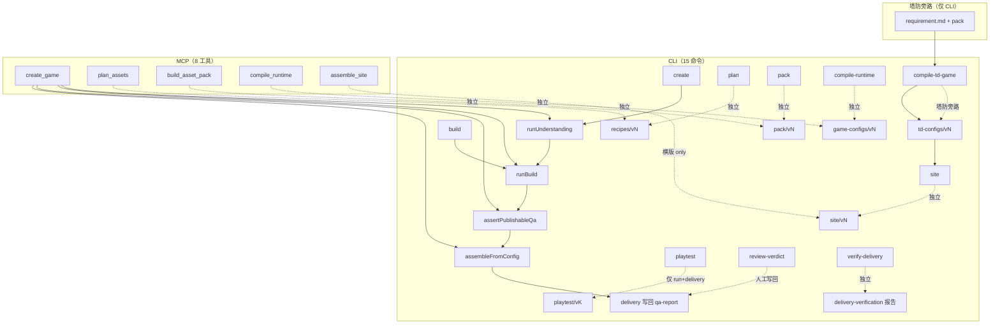

# P0-01B · 真实生成管线与入口（只读审计）

| 属性 | 值 |
|---|---|
| 审计基线 | `2c1a9d5`（`2c1a9d55c1ac94bc5271318514897b9485587bec`，分支 `main`，2026-10-29） |
| 工作区 | 干净（仅未跟踪 `.scratch/p0-01-audit/` 与 `docs/v7.6/管线.md`；本票未修改生产代码） |
| 审计方式 | 只读 shell（`git` / `rg` / `find` / `ls` / `sed` / `cat` / `node -e` 读 JSON）；未运行 `pnpm test` / `build` / `typecheck` / playtest / site / create / pack |
| 输入 | `docs/v7.6/管线.md` §P0-01B（未提交工作区文件，`docs/v7.6/管线.md:122`） |
| 词汇权威 | `CONTEXT.md`（本报告只借用其中既有词汇，不新增领域词） |
| 证据分级 | E1 源码 · E2 测试 · E3 真实产物/运行证据；历史 E3 均注明来源 commit 与适用边界 |

> 本票只做**调用链与入口映射**。能力判定、机制矩阵、候选推荐分别留给票 04 / 05 / 07。发现的问题只作为线索记录，不在本轮修复。

---

## 0. 结论先行

1. **真实管线不是一条线性链，而是两条生产链 + 一组独立命令。** 横版（`game-config/v1`）有完整生成链：`create` / `build` → 理解六步 → 资源包 → 配置 → QA → 站点 → 交付信封。塔防（`td-config/v1`）是旁路：`需求文本 + 资源包 → compile-td-game → td-config → site`，**不经过设计层、不跑 QA、不写 delivery、不能 playtest**。`plan` / `pack` / `compile-*` / `site` / `verify` / `inspect` / `accept` / `review` / `playtest` / `verify-delivery` 是独立命令，彼此不自动串联。
2. **横版主链的真实代码路径**：CLI `create`（`packages/cli/src/cli.ts:576-600`）或 `build`（`cli.ts:601-612`）→ `buildAndSite`（`cli.ts:247-297`）→ `runUnderstanding`（`packages/pipeline/src/create-game.ts:285-469`）→ `runBuild`（`create-game.ts:471-691`）→ 壳层发布闸（`cli.ts:268-271`）→ `assembleFromConfig`（`packages/demo/src/assemble.ts:53-66`）→ `buildSiteSuccessDelivery` / `buildSiteFailureDelivery` 并写回 `qa-report.json`（`cli.ts:283-295`）。
3. **MCP 只有 8 个工具**（`packages/mcp/src/server.ts:80-231`，测试 `packages/mcp/tests/server.test.ts:77`），CLI 有 15 个命令（`cli.ts:26-40`）。MCP 没有 `build`、`compile-td-game`、`playtest`、`review`、`review-verdict`、`playtest-baseline`、`verify-delivery`；MCP 的 `assemble_site` 直接调 `assembleSite`，**只能装横版**（`server.ts:430-444`）。
4. **MCP 的手工组合路径走不通横版发布**：`build_asset_pack` 只产包（`server.ts:278-291`），`compile_runtime` 只产配置（`server.ts:340-349`），两者都不跑 QA；而 `assemble_site` 的发布闸要求一份属于该包的 QA 报告（`server.ts:433-437`、`packages/pipeline/src/publish-gate.ts:145`）。MCP 没有“从 run 构建 / 跑 QA”的工具 ⇒ **只有 `create_game`（`server.ts:350-429`）能走完横版全链**。
5. **独立 `site` 不写 delivery**（`cli.ts:680-704` 只调用闸 + 装配）。而 `playtest` 要求 `delivery.site.status === "pass"` 且 `delivery.checks.qa === "pass"`（`packages/cli/src/playtest.ts:116-125`）。⇒ `plan/pack/compile-runtime/site` 手工产出的站点**不能被 playtest 使用**；只有 `create --yes` / `build` 产出的 run 才有可试玩的 delivery 信封。
6. **横版 QA 实际是 7 条判据，不是文档写的 6 条**：`QA_JUDGEMENTS` 现有 7 项（`packages/contracts/src/qa.ts:111-158`，含 `visual-config-coherence`），真实报告 `checked` 也是 7/7（`.scratch/fpvs-v1-p0/runs/2026-10-26-e2e-r4/wasteland-scavenger-recipe/run/v1/qa-report.json`）。但多处文案仍写“六条/六判据”（`qa.ts:22,104,356,434`、`delivery.ts:93`、`create-game.ts:215,225,644`、`publish-gate.ts:124`）。**代码用 `QA_JUDGEMENTS` 动态判满，功能不受影响；这是命名/文案漂移**（见 §7-B6）。
7. **最完整的真实 E3 是 one-off 冻结 demo，不是 HEAD 新跑**：原始 `create` 运行在 `040b907`（2026-10-26），冻结副本在 `5b8283f`；playtest v1/v2 由 CLI 写出（harness `playtest-harness/v1` / `playtest-rules/v1`），视觉评审在 `f458beb`，证据完整性正式重验在 HEAD `2c1a9d5`。`ae339b9..2c1a9d5` 之间**主生成链文件未改**（`git diff --name-only` 对 `create-game.ts` / `ops.ts` / `demo/src` / `server.ts` / `qa.ts` / `delivery.ts` 为空；`packages/cli/src/cli.ts` 只新增 `verify-delivery` 的 14 行），但 **playtest 契约/harness 从 v1 升到 v2**（`packages/contracts/src/playtest.ts:18-24` 与 `8e92c69` diff），所以旧 playtest E3 **不能直接外推到 HEAD 的 v2 归因/写回**。
8. **冻结 demo 的 delivery 信封不是生产壳写出来的**：原始 `qa-report.json` 没有 `delivery`（`create.log` 中 `delivery` 出现 0 次），冻结工作区里的 delivery 是由 `.scratch/fpvs-v1-final/acceptance/init-delivery.mjs`（`5b8283f`）调用 `buildSiteSuccessDelivery` + `writeDeliveryToReport` **人工初始化**的。当前 `buildAndSite` 的 delivery 写回只有 E1 + 分层 E2（`packages/pipeline/tests/delivery-integration.test.ts`），**没有经过 CLI/MCP 壳的端到端测试或真实运行证据**。
9. **`verify-delivery` 是对“冻结清单”的只读验证，不是生成链的一环**：CLI `verify-delivery`（`cli.ts:820-828`）→ `verifyDeliveryEvidence`（`packages/pipeline/src/evidence-integrity.ts:1177`）；清单生成器 `.scratch/evidence-integrity-v1/tools/build-manifest.mjs` **不在 `packages/` 里**，MCP 也没有对应工具。HEAD 的最终验收报告证明“冻结证据未被改动、六项声明与重算一致”，**不证明当前 HEAD 能重新生成同一交付**。
10. **测试强在 E2、弱在真实入口**：主链测试全部用 `fixtures/upstream/canned.json` + 假 `fetch`（`packages/pipeline/tests/upstream.ts:1-12`、`packages/cli/tests/cli-create.test.ts:20-24`）；浏览器只在 `test:playtest` / `test:acceptance` / probes 里跑，均不在 `pnpm test` 内（`package.json:13-17`）。CLI `create --yes` 测试还依赖**未跟踪的** `packages/demo/dist/shell.js`（`packages/cli/tests/cli-create.test.ts:178-182`；`.gitignore:5`），干净 clone 直接跑 `pnpm test` 不保证成立。

---

## 1. 口径：真实、文档、fixture 三种“存在”

- **E1 真实调用链**：实际被 CLI/MCP 生产分支调用的函数与文件。本报告用 `path:line` 标注。
- **E2 测试/替身**：只在 `*.test.ts`、`fixtures/`、假 `fetch`、`shell.js` 桩里成立的路径。会显式标“仅测试”。
- **E3 真实运行证据**：有命令、退出码、身份（pack/site/config 哈希）与可追溯路径的历史运行。历史 E3 只证明**对应 commit + 对应交付身份 + 对应场景**，不自动升级为 HEAD 的证明。
- **文档预期**：`README.md` 的管线图（`README.md:16-22`）、`docs/v7.6/管线.md:126-128` 的线性八段描述。它们描述的是**设计意图**，不是当前分支的完整事实；真实分支见 §2-§4。
- **目录存在 ≠ 功能完整**：`fixtures/playtest-baselines/` 存在但只有 `README.md`（无任何 `baseline.json`）；`out/`、`packages/*/dist/` 存在但都被 `.gitignore` 忽略（`.gitignore:5,10`），`dist/shell.js` 是未入库构建产物。见 §7-E。

---

## 2. 真实全景：两条生产链 + 三个入口面

**平台横版真链**：`输入（style.png + intent）→ 理解六步 → asset-recipe → pack → verify → game-config → QA（7 判据 + 机制覆盖）→ 发布闸 → site → delivery`。站点装配在**壳层**，不在 `pipeline`（`packages/pipeline/src/index.ts:3-4` 明确 `pipeline` 够不着 `demo`）。

**塔防旁路**：`需求文本 + 已有资源包 → compile-td-game → td-config → site`。旁路**没有** `GameIntentSpec / GameDesignSpec / CharacterDNA / VisualDesign / AssetRecipe` 这些理解层产物；它的 QA 闸被显式跳过（`publish-gate.ts:145-147`），因此也没有 delivery/playtest。

**独立命令面**：这些命令都各自从磁盘读输入、写自己的版本目录，**不会触发 QA、不会写 delivery、不会自动进入下一步**。

---

## 3. 分阶段调用链

### 3.1 输入（需求文本 / 参考图 / 上游凭据）

| 项 | 内容 |
|---|---|
| 入口 | CLI `create`：`--style`（恰好 1 张）+ `--intent`（裸文本或 `.md/.txt` 路径）；`build`：只吃 run 目录；MCP `create_game`：`stylePath` + `intent`。`--out` 默认 `./out`。 |
| 关键实现 | `cli.ts:576-590`；`readRequirement` 的路径判别规则在 `cli.ts:218-235`；MCP 的同一规则在 `server.ts:24-32`；上游解析 `resolveTextTransport`（`packages/assets/src/text-config.ts:60`）与 `resolveImageTransport`（`packages/assets/src/image-config.ts:103`）在壳层执行（`cli.ts:556-563`、`server.ts:66-77`）。 |
| 契约 | 需求是**一段文本**，不是 schema（`CONTEXT.md` 的 `Requirement`，`CONTEXT.md:64-72`）；`--intent` 的“像路径就当路径”是壳规则，不写进契约。参考图由 `StyleReferencePath` 约束为相对路径（`styleRefOf`，`create-game.ts:267-269`）。 |
| 下游 | `runUnderstanding` 把需求原样写进 `intent.md`（`create-game.ts:297`）。 |
| 失败 / 产物 | 缺 `--style` / `--intent`、路径看起来存在但不存在 ⇒ `CommandError("usage")` 退出 2（`cli.ts:578-580`、`cli.ts:226-232`）。`intent.md` 进 staging，失败后随 `abandonRun` 留在失败现场。 |
| 测试 | `packages/cli/tests/cli-create.test.ts:217-246`（裸文本 / `.md` / 路径误判）；`packages/cli/tests/cli-create.test.ts:477-496`（参数硬线）。 |
| 真实证据 | `.scratch/fpvs-v1-p0/runs/2026-10-26-e2e-r4/create.log`（`040b907`，`command: create`，`EXIT=0`）；冻结副本 `run/v1/intent.md`、`style.png`、`reference.png`。 |
| 未覆盖 | `create` 只收 **1 张 PNG**：多于 1 张在 `runUnderstanding` 拒绝（`create-game.ts:304-305`），非 PNG 在**第一笔上游之前**拒绝（`create-game.ts:307-312`）；多参考图、jpg/webp 参考图均未实现。真实 E3 只有 1 个需求 / 1 张图。 |

### 3.2 设计与意图（横版理解层）

| 项 | 内容 |
|---|---|
| 入口 | 只有 `runUnderstanding`（`create-game.ts:285-469`）：CLI `create` 与 MCP `create_game` 都走它；`createGame` 包装函数（`create-game.ts:693`）**只在测试里被调用**（`packages/pipeline/tests/create-game.test.ts:12,294-297`）。 |
| 关键实现 | `writeIntentMd` → `analyzeReference`（`packages/vision/src/analyze-reference.ts:286`）→ `writeVisualWorld`（拷参考图、改写路径，`packages/pipeline/src/artifacts.ts:58-78`）→ `analyzeIntent`（`packages/game-design/src/analyze-intent.ts:178`）→ `compileDesign`（`packages/game-design/src/compile-design.ts:218`）→ `compileCharacterDna`（`packages/game-design/src/compile-character-dna.ts:163`）→ `compileVisualDesign`（`packages/visual-design/src/compile.ts:30`，纯计算）→ `planAssets`（`packages/assets/src/ops.ts:370`）。顺序落盘在 `create-game.ts:314-403`。 |
| 契约 | `VisualWorldSpecSchema`（`packages/contracts/src/visual-world.ts:160`）、`GameIntentSpecSchema`（`game-intent.ts:130`）、`GameDesignSpecSchema`（`game-design.ts:124`）、`CharacterDNAFileSchema`（`character-dna.ts:162`）、`VisualDesignSpecSchema`（`visual-design.ts:79`）。`GameDesignSpec.game.runtimeProfile` 决定这一代外壳（`runtime-profile.ts:114-129`），今天只有 `platformer/v1`。 |
| 下游 | 六步产物写 staging：`visual-world.json` / `game-intent.json` / `game-design.json` / `character-dna.json` / `visual-design.json` + `visual-design/{svg,preview}`；清单在 `create-game.ts:381-401` 注入 `characterRef`、重过 `parseRecipe`、摊平后写入 `asset-recipe.json`。最终 `commitRun` 一次 rename 到 `run/v<N>`（`create-game.ts:403`、`packages/pipeline/src/run.ts:75`）。 |
| 失败 / 产物 | 任何一步失败 ⇒ `abandonRun` **改名留现场、不删**（`create-game.ts:448`、`run.ts:108-117`），现场在 `<gameId>/run/failed-<ts>/` 或 `out/.failed-<ts>/`；被拒设计另留 `design-attempts.json`、第一步失败留 `visual-world-attempts.json`（`create-game.ts:436-450`）。空色板在 `analyzeIntent` 之前拒（`create-game.ts:332-333`）。 |
| 测试 | `packages/pipeline/tests/create-game.test.ts:47-127`（七项落盘、sidecar、原样字节、账、空色板）；`:372-642`（被拒设计 / 第一步失败现场）；`packages/vision/tests/*`、`packages/game-design/tests/*`、`packages/visual-design/tests/*`、`packages/contracts/tests/{visual-world,game-intent,game-design,character-dna}*.test.ts`。全部离线。 |
| 真实证据 | `.scratch/fpvs-v1-p0/runs/2026-10-26-e2e-r4/.../run/v1/` 的七项 + `visual-design/`；run 账 `run/v1/ledger.json` 记录 `analyze-reference` / `analyze-intent` / `compile-design` / `character-dna` / `plan-assets` 各 1 次（冻结副本，`5b8283f`）。 |
| 未覆盖 | `createGame()` + `onRecipe` 检查点**仅测试**（见 §5）。本审计核对到的、带完整交付身份的 E3 只有废土横版一个设计；没有第二个玩法/设计样本。 |

### 3.3 资源规划与生成

| 项 | 内容 |
|---|---|
| 入口 | 规划：`planAssets`（`ops.ts:370-681`），由 `runUnderstanding` 调（`create-game.ts:381`）或 CLI `plan` 直接调（`cli.ts:613-627`）。生成：`packAssets`（`ops.ts:1681-1835`）→ `buildAssetPack`（`packages/assets/src/pack.ts:307-1312`），由 `runBuild` 调（`create-game.ts:515`）或 CLI `pack` 直接调（`cli.ts:629-647`）。 |
| 契约 | 清单 `asset-recipe/v1`（`packages/contracts/src/recipe.ts:17,373`）；规划 sidecar `asset-plan/v1`（`asset-plan.ts:10`）；路线决策 `resolveRoute`（`packages/assets/src/route.ts:80-120`）决定 `import` / `image` / `drawlist`。 |
| 下游 | 规划：一次强制工具调用文本上游（`PLAN_TOOL_NAME`），三发重采样；过 `parseRecipe` + 四道闸（设计覆盖、HUD UI、玩家三动作、背景覆盖，`ops.ts:482-536`）；写 `<out>/<id>/recipes/vN.json` + `vN.plan.json` + `stylespec.json` + `reference.png`（`ops.ts:580-635`）。生成：文本 `drawlist` 走 `createDrawListGenerator`；`image` 走 `imageGeneratorFor`（`pack.ts:1572`、`ops.ts:1681` 起）；`import` 读既有位图。 |
| 失败 / 产物 | 规划失败：`CommandError("invalid"/"usage"/"upstream")`，账（call）跟着异常走（`ops.ts:520-544`）。生成失败：`buildAssetPack` 把 `.building-*` 改名 `failed-<ts>/`（`pack.ts:288-304`），**只留最近一份非空现场**；生图/文本已花调用挂 `ledger` + `failureDir`（`ops.ts:1770-1810`）。成功包在 `pack/v<N>`（`pack.ts:1304`）。 |
| 测试 | `packages/assets/tests/plan-assets*.test.ts`（含覆盖/HUD/玩家/背景闸、sidecar）、`pack.test.ts`、`pack-*.test.ts`、`route-resolver.test.ts`、`ops.test.ts`（无兜底、失败现场、账、参考图协议）。全部假上游 / fixture。 |
| 真实证据 | 冻结 demo `pack/v1`：`assetpack/v4`，8 个资源、45 个文件（`manifest.json`）；包内 `ledger.json` 记 22 次调用（`run/v1/ledger.json` 同）；`master-ratios.json`、`coverage.json`、`authoring/` 均在。来源 `040b907` / 冻结 `5b8283f`，manifest sha `sha256:a162942d…`。 |
| 未覆盖 | 本审计核对到的完整交付 E3 只有 `generated` 路线的包；`import` / 纯导入 / 程序化路线只有 fixture 测试（`packages/assets/tests/import*.test.ts`、`pack.test.ts:116-186`）。`dashscope-mcp` 不支持参考图，会在花钱前拒（`ops.ts:1701-1722`），没有真实该协议的 E3。 |

### 3.4 AssetPack（交付态资源包）

| 项 | 内容 |
|---|---|
| 入口 | 生成即打包（`packAssets`）；校验：`verifyPack`（`ops.ts:1836-1923`）在 `runBuild` 的包之后、配置之前入链（`create-game.ts:540`），或 CLI `verify`（`cli.ts:706-710`）/ MCP `verify_asset_pack`（`server.ts:292-294`）。 |
| 契约 | `assetpack/v4`（`packages/contracts/src/assetpack.ts:57,335`）；`manifest.assets/atlases/files/provenance/palette`；`files[]` 覆盖包内除 `manifest.json` 外的全部文件（`pack.ts:1269-1276`）。 |
| 下游 | `buildAssetPack` 写 `delivery/atlas.*`、`authoring/`、`ledger.json`、`coverage.json`、`master-ratios.json`、`manifest.json`；自校验 `parseAssetPack` 后才 rename（`pack.ts:1289-1304`）。`verifyPack` 逐文件比 bytes + sha256、检查 `files[]` 穷举、ledger schema/身份、master-ratios schema/身份（`ops.ts:1836-1923`）。 |
| 失败 / 产物 | schema/checksum/缺文件/未记录文件 ⇒ `CommandError("invalid")` 退出 4，包原样保留（`ops.ts:1920`）。 |
| 测试 | `pack-selfcheck.test.ts`、`pack.test.ts`、`pack-frames/master/sheet-grid/reuse-threshold/ground-band/deps` 等；`cli.test.ts:123-146`（篡改后 verify 非 0）；`acceptance.test.ts` 也做 checksum。 |
| 真实证据 | 冻结 demo 包的 45 文件 + 包内 `ledger.json`；HEAD 的 `verify-delivery` 重算 223 个证据文件哈希（`.scratch/evidence-integrity-v1/runs/2026-10-29T05-04-57Z-final-acceptance/report.json`，`2c1a9d5`）——但那是**证据校验器**，不是 `verifyPack` 的 E3。 |
| 未覆盖 | 没有跟踪的 `game-maker verify` 真实运行日志；`verifyPack` 的真实执行只有 E2（及 `runBuild` 内的间接执行，未在真实 E3 日志中单列）。`site` 不重算 checksum，`publish-gate` 明确不做（`publish-gate.ts:16-18`）。 |

### 3.5 GameConfig（横版关卡配置）

| 项 | 内容 |
|---|---|
| 入口 | `compileRuntime`（`ops.ts:1039-1277`），由 `runBuild` 在 staging 调用（`create-game.ts:547-570`）或 CLI `compile-runtime`（`cli.ts:649-663`）/ MCP `compile_runtime`（`server.ts:340-349`）直接调用。塔防旁路见 §3.9。 |
| 契约 | `game-config/v1`（`packages/contracts/src/game-config.ts:30,215`）；验证族 `auditGameConfig` / `auditEntityIdentity` / `auditScreenSpace` / `auditLayerCoverage`（`game-config.ts`、`screen-space.ts`、`layer-coverage.ts`）。 |
| 下游 | 一次强制工具调用（`CONFIG_TOOL_NAME`）→ 三发重采样；模型错族（引用/自洽/HUD 屏幕空间/实体身份）在循环内重采样；层覆盖是确定性硬失败、不重采样、不落盘（`ops.ts:1180-1235`）。产物写 `<out>/<id>/game-configs/vN.json`；`runBuild` 把它 rename 成 `run/vN/game-config.json`（`create-game.ts:550-570`）。 |
| 失败 / 产物 | 上游失败 ⇒ 3；schema/业务校验失败 ⇒ 4；坏配置**不落盘**（`ops.ts:1218-1232`）。`runBuild` 的 staging 在 `finally` 删除（`create-game.ts:566-570`）；若重跑时编译失败，run 里**旧的** `game-config.json` 不会被删。 |
| 测试 | `packages/assets/tests/compile-runtime.test.ts`；`packages/contracts/tests/game-config.test.ts`；`packages/demo/tests/site.test.ts`（同一批审计在装配期再跑）。 |
| 真实证据 | 冻结 demo `run/v1/game-config.json` 与 `site/v1/game-config.json` 同字节，sha `sha256:455d9c7f…`（`artifacts/identity.json`）；真实 create 日志里 `config` 步骤在 `pack` 之后（`040b907/create.log`）。 |
| 未覆盖 | 真实 E3 只有一个横版关卡；MCP `compile_runtime` 不传 `hudLineHeight`（`server.ts:340-349`；CLI 传 `HUD_LINE_HEIGHT`，`cli.ts:661`），今天两者都是 10，但这是**潜在入口漂移**。`compile-runtime` 的真实 E3 不是独立命令运行，而是 `create` 链内的一次调用。 |

### 3.6 QA（构建期判据）

| 项 | 内容 |
|---|---|
| 入口 | `runBuild` 里默认跑 `qaRunner`（`create-game.ts:509,599`），runner 来自 `@game-maker/qa`（`packages/qa/src/assemble.ts:75`）。CLI/MCP 没有直接 QA 命令；`runBuild` 是唯一入口。 |
| 契约 | `qa-report/v1`（`packages/contracts/src/qa.ts:97`）；7 条 `QA_JUDGEMENTS`（`qa.ts:111-158`）；`subject` 绑定 packId/packVersion/manifestChecksum（`create-game.ts:618-625`）；观察两条（`inspect` / `review`）必须齐全（`qa.ts` 的 `superRefine` ④）。 |
| 下游 | 免费 `inspectPack` 观察 + `pixelIntegrity`（`create-game.ts:580-596`）；三族并发（visual/gameplay/intent）+ 合成器直接跑 `layer-coverage`（`qa/src/assemble.ts:85-130`）；报告先落盘（`create-game.ts:635`），再 `assertQaPassed`（`:642`），再机制覆盖闸（`:647-650`），失败时写 `buildQaFailureDelivery`（`:653-656`）。 |
| 失败 / 产物 | error 或 `checked` 不满 7 ⇒ `CommandError("invalid")` 退出 4；`qa-report.json` **已落盘**，站点不产；`delivery` 记 `qa=fail/incomplete`、`site=blocked`、`playable-smoke=blocked`、`visual-review=incomplete`。 |
| 测试 | `packages/pipeline/tests/create-game.test.ts:643-770`（默认跑、null 关、坏报告、硬失败先落盘）；`packages/qa/tests/*`；`packages/contracts/tests/qa.test.ts`；`packages/pipeline/tests/delivery-integration.test.ts:53-74`。 |
| 真实证据 | 冻结 demo `run/v1/qa-report.json`：`checked` 7/7，2 条 `visual-config-coherence` warning、无 error，`qaVerdict=pass`；`observations` 为 `inspect:ok` / `review:unavailable`。 |
| 未覆盖 | QA 只在横版 `runBuild` 里跑；塔防无 QA；MCP 无法对已有 run 触发 QA。`review` 观察在真实报告中是 `unavailable`（生产链不跑付费视觉），人工视觉走的是 `review-verdict`。 |

### 3.7 Runtime（站点装配与外壳）

| 项 | 内容 |
|---|---|
| 入口 | 壳层 `buildAndSite`（`cli.ts:247-297`）或独立 `site`（`cli.ts:680-704`）/ MCP `assemble_site`（`server.ts:430-444`）。装配：`assembleFromConfig`（`packages/demo/src/assemble.ts:53-66`）按 config 的 `format` 分派 `assembleSite`（`packages/demo/src/site.ts:167`）或 `assembleTdSite`（`packages/demo/src/td/site.ts:92`）；目录布局 `laySite`（`packages/demo/src/layout.ts:75-150`）。浏览器运行时是 `packages/demo/src/shell/entry.ts`，由 esbuild 打成 `dist/shell.js`（`packages/demo/package.json:26`），站点只引用它。 |
| 契约 | `site.json` = `{shell, pack, config}`（`layout.ts:133-137`）；`index.html` 用经典 `<script src="./shell.js">`（`layout.ts:118-126`）；外壳按 `site.json.config` + 配置 `format` 选场景（`shell/entry.ts:54-87`）。 |
| 下游 | 发布闸 `assertPublishableQa` 在装配**之前**（`cli.ts:268-271`、`server.ts:433-437`）；横版校验三族 + 几何 + HUD 屏幕空间（`site.ts:195-250`）；塔防再加世界尺寸与可通关模拟（`td/site.ts:155-175`）。成功后写 `site/v<N>` 并**复用/拷入** `pack/v<N>`（`layout.ts:84-108`）。 |
| 失败 / 产物 | 缺 QA/旧包/error/incomplete ⇒ 4，`site/v<N>` 不产（`publish-gate.ts:145-197`）；装配校验失败 ⇒ 4，不产站点；站点成功/失败都会由壳写 delivery（`cli.ts:283-295`）。独立 `site` **不写 delivery**。 |
| 测试 | `packages/demo/tests/site.test.ts`、`td-site.test.ts`、`world.test.ts`、`td-world/sim/winnable.test.ts`、`shell-*`（纯层静态断言）；`packages/cli/tests/cli-site-gate.test.ts`；`packages/pipeline/tests/publish-gate.test.ts`。`pnpm test` **不启动浏览器**。 |
| 真实证据 | 冻结 `site/v1/site.json` = `{shell:"2", pack:"v1", config:"game-config.json"}`；`040b907` 的 `create` 产站点，`040b907` 的 `smoke3/summary-positive.json` 记录真实 Chrome（Chrome/155）打开站点；`f458beb` 的视觉评审有 9 张真实运行截图；塔防真实浏览器读数在 `.scratch/game-maker-v2/experiments/72-two-shell-size`（`d3e9137`，fixture pack `counter-siege/v4` + fixture td-config，Canvas 回退路径）。 |
| 未覆盖 | 塔防站点**只能从 CLI `site`**（MCP `assemble_site` 直接调 `assembleSite`，不能分派 TD）；独立 `site` 的站点没有 delivery，不能 playtest；真实浏览器证据是 **Canvas 回退**（`experiments/72.../README.md` 明确 `canNine=false`），WebGL/九宫格路径未在真实浏览器验证；`dist/shell.js` 未入库，干净 checkout 必须先 `pnpm build`。 |

### 3.8 Playtest

| 项 | 内容 |
|---|---|
| 入口 | **仅 CLI** `playtest`（`cli.ts:765-773`）→ `runPlaytestCommand`（`packages/cli/src/playtest.ts:345-447`）。MCP 无对应工具。 |
| 关键实现 | 六项准备校验（`playtest.ts:106-163`）：run 形状/outRoot 内、`qa-report.json` 有 delivery、`delivery.site` 在且 `qa`/`site` 均 pass、site 目录与 `site.json` 三元组、pack 身份/checksum、run config = site config = delivery.config；再选场景（`selectScenarios`，`playtest.ts:66-103`），复制到 `run/v<N>/playtest/.tmp-<pid>-<ts>/`，`spawnSync` 调 `packages/demo/probe/playtest/playtest.mjs`（`playtest.ts:23-25,368-399`）；归因（`attributeReport`）、写 `playtest/v<K>/result.json` + `site-integrity.json` + `chrome.log` + 每场景 events/trace/input/console/exceptions（`playtest.ts:318-343`），再 `writePlaytestToReport` 写回 `qa-report.json` 的 `delivery.playtest` / `playable-smoke`（`packages/pipeline/src/playtest.ts:27-85`）。 |
| 契约 | `playtest-report/v1`（`packages/contracts/src/playtest.ts:283`）、`playtest-scenario/v1`（`:392`）、`delivery.playtest`（`:455`）；当前 HEAD 的 harness/rules 常量是 **v2**（`playtest.ts:23-24`）。 |
| 失败 / 产物 | 准备拒绝 ⇒ 写 `run/v<N>/playtest/rejections/<ts>.json`，不伪造 attempt，退出 4（`playtest.ts:83-90,345-366`）；harness 没产 `result.json` ⇒ 留 `harness-error.json` 后退出 4（`:381-386`）；非 SUCCESS 或写回失败 ⇒ 退出 1；写回失败另留 `writeback-error.json`（`:405-410`）。 |
| 测试 | `packages/pipeline/tests/playtest.test.ts`（写回）、`playtest-baseline.test.ts`；`packages/contracts/tests/playtest.test.ts`；`packages/cli/tests/playtest-scenario-dir.test.ts`（只测场景选择，不启动浏览器）。浏览器自测在 `pnpm test:playtest`（`package.json:14`），**不在 `pnpm test`**。 |
| 真实证据 | 冻结工作区 `run/v1/playtest/v1` 与 `v2`：`command` 记录的是 `playtest.mjs --site ... --scenario-dir run/v1/playtest/.tmp-...`，`.tmp-` 形状与 `runPlaytestCommand` 的 `workRoot` 一致（`cli/playtest.ts:368`）；两次均 `execution=executed`、`aggregate=SUCCESS`、`won=true`、`collected=6`、`chests=2`、`resets=0`，harness/rules **v1**。另有 `.scratch/generic-playtest-v1/evidence/06-attempt-1/2`：**直接调用 harness** 的 v2 两次运行，同一身份、同一投影、`steps=452/451`（`5f29592`），但 raw `result.json` 没有 `outcome/aggregate`（归因未跑），不是 CLI 写回 E3。 |
| 未覆盖 | 当前 HEAD 的 **v2 CLI 写回**没有 E3；塔防不能 playtest（无 delivery）；`playtest` 依赖系统 Chrome + repo 布局 + 未入库 `dist/shell.js`（`playtest.ts:23-25,189-190`）；没有真实基线（`fixtures/playtest-baselines/` 只有 README）。 |

### 3.9 塔防旁路（`compile-td-game`）

| 项 | 内容 |
|---|---|
| 入口 | CLI `compile-td-game --requirement <需求.md> --pack <包目录>`（`cli.ts:665-679`）→ `compileTdGame`（`ops.ts:1405-1570`）。**MCP 无对应工具**；不在 `create` / `build` 链。 |
| 契约 | `td-config/v1`（`packages/contracts/src/td-config.ts`，`parseTdConfig` / `tdResolveConfig` / `auditTdConfig` / `auditTdWorldSize`）；`path` 不在模型输出里，由 `tdResolveConfig` 从地图派生（`ops.ts:1495-1510`）。 |
| 下游 | 读原始需求文本（不经过 `GameIntentSpec/GameDesignSpec`），一次工具调用（`attempts` 默认 3），每次 `tdResolveConfig` 补路径，再跑 `auditTdConfig` + `auditTdWorldSize` + `auditScreenSpace`；**坏关卡也落盘**（`ops.ts:1522-1530`），并在 `site` 再由 `auditTdGeometry` + `auditWinnable` 决定是否装配（`td/site.ts:155-175`）。 |
| 失败 / 产物 | 没有一次过 schema ⇒ 4，不落盘；过 schema 但校验不过 ⇒ 落 `td-configs/vN.json`、报告问题、仍继续（人可改）。空 transport 只判 `!opts.transport`（`ops.ts:1412`），**没有像 `compileRuntime` 那样检查 `baseUrl===""`/`apiKey===""`**（`ops.ts:1080`）⇒ CLI 传的空 `{baseUrl:"",apiKey:""}` 会进入网络路径，可能把本地配置错记成 upstream/1。 |
| 测试 | `packages/assets/tests/compile-td-game.test.ts`、`compile-td-game-error-class.test.ts`；`packages/contracts/tests/td-config.test.ts`；`packages/demo/tests/td-*.test.ts`；`packages/cli/tests/cli-site-gate.test.ts:149`（TD 跳过 QA 闸）。 |
| 真实证据 | 没有跟踪的“模型真实产出 td-config”的 E3；`.scratch/p0-construction-v1/runs/2026-10-21-ticket-03/raw/counter-siege-v4.json` 是 `inspect` 输出，不是 compile 输出。真实塔防浏览器证据用的是 `fixtures/td-configs/counter-siege.json` + `fixtures/packs/counter-siege/v4`（`.scratch/game-maker-v2/experiments/72-two-shell-size`，`d3e9137`）。 |
| 未覆盖 | TD 的生成式编译没有真实 E3；TD 无 QA / delivery / playtest；MCP 不能编译 TD、不能装 TD 站点；TD 的 QA 等价被 `publish-gate.ts:145-147` 显式跳过（P2）。 |

### 3.10 交付验证（delivery / 人工视觉 / 证据完整性）

这里要区分**四个不同东西**：

| 机制 | 是什么 | 入口 / 实现 | 真实证据 |
|---|---|---|---|
| `delivery` 信封 | `qa-report.json` 顶层的六检查项 + 四值 verdict（`asset-pack/config/qa/site/playable-smoke/visual-review`），由 `deriveDeliveryVerdict` 汇总 | 契约 `packages/contracts/src/delivery.ts:46,79,259`；QA 失败提前写 `create-game.ts:653`；站点成功/失败由壳写 `cli.ts:283-295`；playtest 写 `pipeline/src/playtest.ts`；视觉评审写 `pipeline/src/delivery.ts:153` | 冻结 demo `qa-report.json` 的 delivery=`pass`，六项全 pass；但**信封由 `.scratch/fpvs-v1-final/acceptance/init-delivery.mjs` 初始化**（`5b8283f`），原始 `040b907` 的 create 报告**没有** delivery（`create.log` 中 0 次）。 |
| `review-verdict` | 人工视觉结论写回 `delivery.visualReview`（只改三处；不动 QA 层） | CLI `cli.ts:784-818` → `writeVisualReviewToReport`（`pipeline/src/delivery.ts:153-180`） | 冻结 demo 的 `visualReview`：reviewer=`人（本次会话用户）`，2026-10-28，9 张真实按键截图，`review-record.json`（`f458beb`）。 |
| `accept` | **结构验收**（图集/帧/锚点/checksum + 可选 baseline 指标），写 `out/<packId>/acceptance/v<N>/report.json|md`；不是 delivery | CLI `cli.ts:716-729` → `acceptAnimationPack`（`packages/assets/src/acceptance.ts:566`）+ `writeAcceptanceReport`（`:840`）；MCP `accept_asset_pack`（`server.ts:295-339`）；**不在 create/build 链** | `.scratch/p0-construction-v1/runs/2026-10-22-final/accept-v7/ruin-scavenger-extraction-assets/acceptance/v1/report.json`（`c619d84`，包 v7，0 findings，无 baseline）。 |
| `verify-delivery` | 对**冻结交付证据清单**做只读重算：清单 schema、双端 realpath、文件哈希、身份、三方哈希、站点完整性、playtest 投影、视觉材料、报告引用、六项声明 vs 重算 | CLI `cli.ts:820-828` → `packages/cli/src/evidence.ts:15-63` → `verifyDeliveryEvidence`（`evidence-integrity.ts:1177`）；报告 `writeVerificationReport`（`:1154`）；脚本 `scripts/evidence-acceptance.mjs` / `pnpm test:evidence`（`package.json:17`）；**MCP 无** | HEAD 最终报告 `.scratch/evidence-integrity-v1/runs/2026-10-29T05-04-57Z-final-acceptance/report.json`（`2c1a9d5`）：status pass、exit 0、223 文件（151 required/72 optional）、13 records、six checks 全 match、diagnostics 0；清单 sha `sha256:ba7a485b…`。 |

**交付验证的真实边界**：

- `delivery` 是**报告里的一个对象**，不是单独的交付文件；`site` 装配成功/失败与 `playtest` / `review-verdict` 都会**重写/合并**同一个 `qa-report.json`（原子写或临时文件 + rename）。历史真实 demo 的 delivery 是**事后初始化**的，不是当前 `buildAndSite` 的 E3。
- `verify-delivery` **不覆盖**“当前 HEAD 新生成一个交付”的场景；它验证的是 `.scratch/evidence-integrity-v1/manifest/expected-hashes.json` 声明的冻结文件。清单生成器 `.scratch/evidence-integrity-v1/tools/build-manifest.mjs` 是 effort 工具，未被 `packages/` 引用（`rg build-manifest packages scripts` 只命中测试与脚本的默认路径）。
- `publish-gate` **只钉 pack 身份，不钉 config 身份**（`publish-gate.ts:12-15` 自陈）；同一份绿色 pack 报告可给另一份手写 config 放行。这是代码里明写的残余风险，不是本票新增判断。
- `review`（付费视觉诊断）**不在交付链**：`review` 只被 CLI 调（`cli.ts:775-783`），`reviewRun` 明确不碰 `createGame/runBuild/runUnderstanding`（`packages/pipeline/src/review.ts:5-9`），也不写 delivery；今天只有测试，没有跟踪的真实 `review` 运行证据。

---

## 4. 入口差异表

### 4.1 CLI 命令（15）

| # | 命令 | 真实实现 | 是否在横版 create/build 链 | 是否写 delivery | 备注 |
|---|---|---|---|---|---|
| 1 | `create` | `cli.ts:576-600` → `runUnderstanding` + `buildAndSite` | 是（第一段；`--yes` 连第二段） | `--yes` 时写；停住时不写 | 停在清单是**退出 0** + `status=awaiting`（`cli.ts:591-594`） |
| 2 | `build` | `cli.ts:601-612` → `buildAndSite` | 是（第二段） | 成功/失败写（`site` 之后） | 只吃 run 目录；清单从磁盘读回 |
| 3 | `plan` | `cli.ts:613-627` → `planAssets` | 否（独立） | 否 | 写 `<out>/<id>/recipes/vN.json` + sidecar；不跑 QA |
| 4 | `pack` | `cli.ts:629-647` → `packAssets` | 否（独立） | 否 | 写 `<out>/<id>/pack/vN`；不 verify、不 QA |
| 5 | `compile-runtime` | `cli.ts:649-663` → `compileRuntime` | 否（独立） | 否 | 写 `<out>/<id>/game-configs/vN.json`；不落 run |
| 6 | `compile-td-game` | `cli.ts:665-679` → `compileTdGame` | 否（塔防旁路） | 否 | 写 `<out>/<id>/td-configs/vN.json`；无 QA/无 delivery |
| 7 | `site` | `cli.ts:680-704` → `assertPublishableQa` + `assembleFromConfig` | 否（独立；横版需 QA 报告，TD 跳过） | **否** | 独立站点无 delivery ⇒ 不能 playtest |
| 8 | `verify` | `cli.ts:706-710` → `verifyPack` | 否（独立） | 否 | 包 schema + 逐文件 checksum |
| 9 | `inspect` | `cli.ts:711-715` → `inspectPack` | 否（独立；`runBuild` 内部也调一次作 QA 观察） | 否 | 只报数，不判 |
| 10 | `accept` | `cli.ts:716-729` → `acceptAnimationPack` + `writeAcceptanceReport` | 否（独立） | 否 | error findings ⇒ 退出 1，报告照落盘 |
| 11 | `playtest-baseline promote` | `cli.ts:730-764` → `promotePlaytestBaseline` | 否（人工显式） | 否 | 写 `fixtures/playtest-baselines/<id>/baseline.json`；已存在默认拒 |
| 12 | `playtest` | `cli.ts:765-773` → `runPlaytestCommand` | 否（事后命令） | **是**（写 `delivery.playtest` / `playable-smoke`） | 仅 CLI；要求 run + delivery + site pass |
| 13 | `review` | `cli.ts:775-783` → `reviewRun` | 否（人主动的付费诊断） | 否（只记 run 级账） | 不在链上；无真实 E3 |
| 14 | `review-verdict` | `cli.ts:784-818` → `writeVisualReviewToReport` | 否（人工写回） | **是**（`delivery.visualReview`） | 仅 CLI；不改 QA 层 |
| 15 | `verify-delivery` | `cli.ts:820-828` → `verifyDeliveryEvidence` | 否（独立验收） | 否 | 只读清单 + 新目录写报告；MCP 无 |

### 4.2 MCP 工具（8）

| 工具 | 实现 | 与 CLI 的关系 | 是否生产链完整能力 |
|---|---|---|---|
| `plan_assets` | `server.ts:267-277` | 与 CLI `plan` 同一个 `planAssets` | 单步 |
| `build_asset_pack` | `server.ts:278-291` | 与 CLI `pack` 同一个 `packAssets`；额外传 image transport（`server.ts:284-289`） | 单步；不 QA |
| `verify_asset_pack` | `server.ts:292-294` | 与 CLI `verify` 同一个 `verifyPack` | 单步 |
| `accept_asset_pack` | `server.ts:295-339` | 与 CLI `accept` 同一个 `acceptAnimationPack` / `writeAcceptanceReport` | 单步 |
| `create_game` | `server.ts:350-429` | 自己串 `runUnderstanding → runBuild → assertPublishableQa → assembleSite → delivery`；**恒跑完**，无检查点 | 横版全链；等于 CLI `create --yes`，但用 `assembleSite` 而非 `assembleFromConfig` |
| `inspect_asset_pack` | `server.ts:445-446` | 与 CLI `inspect` 同一个 `inspectPack` | 单步 |
| `compile_runtime` | `server.ts:340-349` | 与 CLI `compile-runtime` 同一个 `compileRuntime`；不传 `hudLineHeight` | 单步 |
| `assemble_site` | `server.ts:430-444` | 只调 `assembleSite`（横版）；**不能分派 TD**；默认 shell 是相对路径字符串 `"packages/demo/dist/shell.js"` | 单步，需已有 QA 报告 |

**MCP 入口差异（关键）**：
- 无 `build`：MCP 不能对人改过的 run 重新构建。
- 无 `compile_td_game` / TD site：塔防完全不可从 MCP 走。
- 无 `playtest` / `review` / `review-verdict` / `playtest-baseline` / `verify-delivery`。
- **手工组合 `plan_assets → build_asset_pack → compile_runtime → assemble_site` 在横版上会在最后一步被 QA 闸拒绝**（没有工具能产 QA 报告）；因此 MCP 的横版完整能力实际上只有 `create_game` 一条。
- `create_game` 不传 `hudLineHeight`（`server.ts:365-371`），CLI `buildAndSite` 传 `HUD_LINE_HEIGHT`（`cli.ts:260`）；今天两值都是 10，但入口参数面不对称。

### 4.3 其他真实入口（脚本 / probe / effort 工具）

| 入口 | 作用 | 是否生产 CLI/MCP | 证据 / 备注 |
|---|---|---|---|
| `pnpm test` | `vitest run`（`package.json:13`） | 测试 | 不 build；`cli-create` 依赖未入库 `dist/shell.js`（`packages/cli/tests/cli-create.test.ts:178-182`） |
| `pnpm test:playtest` | build + harness self-test + 指定测试（`package.json:14`） | 测试（真 Chrome） | 不在 `pnpm test`；HEAD 的最终验收记录 exit 0（`2c1a9d5` 的 final-acceptance.md） |
| `pnpm test:acceptance` | build + `free-acceptance.mjs`（`package.json:16`） | 验收脚本 | 免费闭环；真实记录见 final-acceptance.md |
| `pnpm test:mechanic` | build + `mechanic-probe.mjs`（`package.json:15`） | 验收脚本（真 Chrome） | 机制 probe |
| `pnpm test:evidence` | build + `scripts/evidence-acceptance.mjs`（`package.json:17`） | 正式证据校验入口 | 调 `packages/cli/dist/cli.mjs verify-delivery`（`scripts/evidence-acceptance.mjs:24,30`） |
| `packages/demo/probe/playtest/playtest.mjs` | Playtest harness | 被 CLI `playtest` `spawnSync` 调用（`cli/playtest.ts:23-25,191`） | 也可直接跑；generic v2 证据就是直接跑 |
| `packages/demo/probe/smoke.mjs` / `smoke-td.mjs` | 真浏览器冒烟（HTTP server + Chrome） | 独立 probe | 不进 CI；`smoke3/summary-positive.json`（`040b907`） |
| `packages/demo/probe/mechanic-probe.mjs` | 机制级运行时断言 | 独立 probe | 被 `test:mechanic` 调用 |
| `packages/demo/probe/td-sweep.mjs` / `td-balance.mjs` | 塔防数值扫描 / 平衡回路 | 独立 probe | 不是生成链 |
| `.scratch/evidence-integrity-v1/tools/build-manifest.mjs` | 生成冻结期望哈希清单 | **effort 工具，不在 packages** | 一次性；校验器只读 |
| `.scratch/fpvs-v1-final/acceptance/init-delivery.mjs` | 给冻结 work 初始化 delivery 信封 | **effort 工具，不在 packages** | 真实 demo 的 delivery 由此初始化（`5b8283f`） |
| `.scratch/fpvs-v1-final/freeze.mjs` | 冻结快照 / 哈希 | **effort 工具** | 历史产物 |

---

## 5. 真实 vs 文档 vs fixture / 测试替身

### 5.1 仅存在于测试 / fixture 的路径（不得当作生产能力）

- `createGame()` + `onRecipe` 检查点：只被 `packages/pipeline/tests/create-game.test.ts:294-297` 调用；CLI 的“停住”是 `awaitingCheckpoint`（`cli.ts:591-594`），MCP 不传检查点。**生产壳都不走 `createGame()`。**
- `qa: null` 关掉 QA、自定义 `QaRunner`、`inspect` / `verify` 注入：只有测试传（`create-game.ts:116-150` 类型注释；`packages/pipeline/tests/create-game.test.ts:643-713`）。
- `packages/pipeline/tests/upstream.ts` / `fixtures/upstream/canned.json`：假文本/生图上游；所有主链测试都用它（`packages/pipeline/tests/upstream.ts:1-12`，`packages/cli/tests/cli-create.test.ts:20-24`）。
- `shellOf` 写 `"// shell stub\n"`：CLI/MCP 站点闸测试的壳替身（`packages/cli/tests/cli-site-gate.test.ts:47-52`、`packages/mcp/tests/assemble-site-qa-gate.test.ts:26-29`）。
- `fixtures/packs/last-train/v2`、`fixtures/packs/counter-siege/v4`、`fixtures/td-configs/counter-siege.json`、`fixtures/game-configs/last-train.json`：入库 fixture，不是 HEAD 生成结果；测试与 TD 浏览器实验都用它们。
- `packages/demo/probe/playtest/scenarios/five-state/`：默认五态场景；其中只有 `success-basic.json` 是 `required:true`（其余 `required:false`，见 `cli/playtest.ts:89-95` 的筛选）。
- `fixtures/playtest-baselines/`：**只有 README，没有任何 `baseline.json`** ⇒ 基线晋升功能有实现/测试（`packages/pipeline/tests/playtest-baseline.test.ts`），但**没有真实基线**。
- `out/`、`packages/*/dist/`：本地构建产物，`.gitignore:5,10`；目录存在不代表已入库或可复现。

### 5.2 文档预期 vs 代码事实

| 文档说法 | 代码事实 |
|---|---|
| `README.md:16-22` 画出一条 `plan → pack → compile → site` 的线性管线 | 真实横版主链是 `create/build` 的 `runUnderstanding → runBuild → site`；`plan/pack/compile-*` 是独立命令，且 `site` 有 QA 闸（README 自己在 `README.md:83` 承认） |
| `README.md:208` 说 MCP 有 **6** 个工具 | 代码有 **8** 个（`server.ts:80-231`，测试 `server.test.ts:77`）；README 漏了 `accept_asset_pack` 与 `create_game` |
| `docs/v7.6/管线.md:126-128` 的八段线性序列 | 横版大体成立（站点/交付在壳层），塔防旁路跳过设计/QA/playtest/delivery；独立命令不自动串 |
| `qa.ts` / `delivery.ts` / `create-game.ts` 多处写“六条判据” | `QA_JUDGEMENTS` 是 **7** 条（`qa.ts:111-158`）；真实报告 `checked` 7/7。代码按数组动态判满，**功能无碍，文案漂移** |
| `delivery.ts:93` 标签 `"qa": "QA 六判据"` | 同上，标签少算 `visual-config-coherence` |
| `README.md` / `docs/v7.6` 把“交付验证”当作独立阶段 | 真实横版链里 delivery 写在 `qa-report.json`；`verify-delivery` 只验冻结清单，不在生成链内 |

---

## 6. 测试与真实证据索引

### 6.1 自动化测试（E2）

| 阶段 | 测试文件 | 覆盖范围 |
|---|---|---|
| 输入 / 壳参数 | `packages/cli/tests/cli.test.ts`、`cli-create.test.ts:217-246,477-496` | 参数解析、`--intent` 路径判别、退出码、并发 flag |
| 理解层 | `packages/pipeline/tests/create-game.test.ts:47-127,372-642`；`packages/vision/tests/*`；`packages/game-design/tests/*`；`packages/visual-design/tests/*` | 六步产物、失败现场、被拒设计、空色板、VDS |
| 规划 | `packages/assets/tests/plan-assets*.test.ts`、`route-resolver.test.ts`、`plan-sidecar.test.ts` | 覆盖/HUD/玩家/背景闸、路线决策、sidecar、重采样 |
| 生成 / 包 | `packages/assets/tests/pack*.test.ts`、`import*.test.ts`、`ops.test.ts` | 包结构、导入、失败现场、账、无降级链、协议能力 |
| AssetPack 校验 | `cli.test.ts:123-146`、`acceptance.test.ts`、`pack-selfcheck.test.ts` | 篡改检测、schema、自校验 |
| GameConfig | `packages/assets/tests/compile-runtime.test.ts`；`packages/contracts/tests/game-config.test.ts` | 示例过 schema、重采样、确定性层覆盖、业务校验 |
| QA | `packages/qa/tests/*`；`create-game.test.ts:643-770`；`packages/contracts/tests/qa.test.ts` | 三族 + 层覆盖、报告落盘先于阻断、incomplete |
| Runtime | `packages/demo/tests/site.test.ts`、`td-site.test.ts`、`world/td-*.test.ts`、`shell-*`；`cli-site-gate.test.ts` | 装配校验、发布闸、TD 分派、纯层运行逻辑 |
| Playtest | `packages/pipeline/tests/playtest.test.ts`、`packages/contracts/tests/playtest.test.ts`、`cli/playtest-scenario-dir.test.ts`、`packages/demo/probe/playtest/tests/*` | 写回、身份拒写、场景选择、投影、归因纯函数 |
| 交付 | `packages/contracts/tests/delivery.test.ts`、`packages/pipeline/tests/delivery-integration.test.ts`、`review-verdict.test.ts`、`review.test.ts` | 六项 verdict、QA 失败提前 delivery、视觉写回、review 记账 |
| 证据完整性 | `packages/pipeline/tests/evidence-integrity.test.ts`（18+ 负向用例）、`packages/cli/tests/evidence.test.ts` | 篡改/缺失/身份/三方/站点/playtest 投影/只读/确定性/--out 越界 |
| MCP | `packages/mcp/tests/{server,create-game-qa-failure,assemble-site-qa-gate,build-pack-stdio,error-semantics}.test.ts` | 8 工具协议、create_game QA 失败、站点闸、凭据、错误码 |

### 6.2 真实运行证据（E3，全部注明来源 commit 与边界）

| 证据 | 路径 | 身份 / 关键事实 | 来源 commit | 对本 HEAD 的适用性 |
|---|---|---|---|---|
| 原始 `create` 真实运行 | `.scratch/fpvs-v1-p0/runs/2026-10-26-e2e-r4/create.log` + `.../wasteland-scavenger-recipe/{run,pack,site}/v1` | `command=create`、`EXIT=0`；8 资源 / 45 文件；pack v1 / site v1 / shell 2；manifest sha `sha256:a162942d…`；config sha `sha256:455d9c7f…` | `040b907`（2026-10-26） | 主生成链文件在 `ae339b9..HEAD` 未改；但这是**历史运行**，不是 HEAD 重跑；原始报告**无 delivery** |
| 冻结工作区 | `.scratch/fpvs-v1-final/work/wasteland-scavenger-recipe/` | 同身份；delivery=`pass`；`visualReview=pass`；playtest v2 `SUCCESS` | 冻结 `5b8283f`；视觉 `f458beb`；最终聚合 `5f29592` | delivery 由 `acceptance/init-delivery.mjs` 初始化；playtest 是 harness/rules **v1** |
| 真实 Playtest（CLI 写回） | `.../run/v1/playtest/v1/result.json`、`v2/result.json` | `execution=executed`、`aggregate=SUCCESS`；`won=true`、`collected=6`、`chests=2`、`resets=0`；harness/rules v1 | `5b8283f` | `.tmp-<pid>-<ts>` 路径与 `runPlaytestCommand` 一致；**不是 HEAD v2 的证据** |
| Playtest harness v2（直接调用） | `.scratch/generic-playtest-v1/evidence/06-attempt-1|2/attempt-v1/result.json`、`06-reproducibility.json` | 两次同身份、同投影、`steps=452/451`、`sameProjection=true`；raw 无 `outcome/aggregate` | `5f29592`（2026-10-28） | 证明 v2 harness 能跑；**没有 CLI 归因/写回**，不是交付 E3 |
| 人工视觉评审 | `.scratch/fpvs-v1-final/runs/2026-10-28-visual-review/review-record.json` + `materials.json` + `shots/` | reviewer=`人（本次会话用户）`；pack/site/shell 身份绑定；9 张真实按键截图 | `f458beb`（2026-10-28） | 真实人工判断；不是自动视觉模型 `review` |
| 证据完整性最终验收 | `.scratch/evidence-integrity-v1/runs/2026-10-29T05-04-57Z-final-acceptance/report.json` | status pass、exit 0、223 文件（151 required/72 optional）、13 records、六项全 match、diagnostics 0；清单 sha `sha256:ba7a485b…` | `2c1a9d5`（HEAD） | 只验证**冻结清单覆盖的旧证据**；不证明 HEAD 能重新生成 |
| 结构验收 | `.scratch/p0-construction-v1/runs/2026-10-22-final/accept-v7/ruin-scavenger-extraction-assets/acceptance/v1/report.json` | `animation-acceptance/v1`；pack v7；0 findings；baseline=null | `c619d84`（2026-10-22） | 旧的独立包；不是当前 wasteland demo |
| TD 真实浏览器 | `.scratch/game-maker-v2/experiments/72-two-shell-size/` | fixture `counter-siege/v4` + fixture td-config；site v1；Chrome readout、`canNine=false`（Canvas 回退） | `d3e9137`（2026-10-24） | 证明 TD 站点能装/能跑；**不是 compile-td-game 的模型输出 E3** |

### 6.3 真实证据缺口（E3 缺失）

- `review`（付费视觉诊断）没有跟踪的真实运行结果。
- `playtest-baseline promote` 没有入库的 `baseline.json`。
- `compile-td-game` 没有真实模型输出；只有 fixture td-config 的站点/浏览器证据。
- 当前 HEAD 的 CLI `playtest`（harness v2 + 写回）没有 E3；只有 harness 直跑的 v2 证据。
- 当前 HEAD 的 `buildAndSite` delivery 写回没有 CLI/MCP 壳级 E3；冻结 demo 的 delivery 是 effort 脚本初始化。
- 没有跟踪的独立 `game-maker verify` 真实日志；包校验的 E3 是证据清单重算，不是 `verifyPack`。
- 没有 TD 的 QA/delivery/playtest 证据；`publish-gate` 明确跳过 TD。

---

## 7. 未覆盖路径与缺口线索（不在本轮修复）

### A. 入口 / 组合能力

1. **MCP 无法从零组合横版站点**：`plan_assets + build_asset_pack + compile_runtime + assemble_site` 缺 QA 产出工具，`assemble_site` 的发布闸会拒（`server.ts:433-437`）。MCP 唯一完整路径是 `create_game`（`server.ts:350-429`）。
2. **MCP 无 `build`**：`create_game` 恒跑完，无法在人工检查点后继续；CLI 的两段式在 MCP 没有等价物。
3. **MCP 无 TD**：没有 `compile_td_game`，`assemble_site` 只调 `assembleSite`（不能分派 TD）。
4. **MCP 无 `playtest` / `review` / `review-verdict` / `playtest-baseline` / `verify-delivery`**：交付闭环的末端只在 CLI。
5. **`createGame()` 生产壳不用**：CLI/MCP 都自己串 `runUnderstanding` + `runBuild`，`createGame` 的 `onRecipe` 检查点只有测试覆盖（见 §5.1）。

### B. 失败语义 / 契约漂移

6. **`runBuild` 的清单/身份/设计 schema 错误抛普通 `Error` ⇒ 退出 1，而不是文档承诺的 4**：`create-game.ts:477-489,499-503` vs CLI 使用说明的“4 = 产物/清单不合法”（`cli.ts:94-96`）。覆盖闸反而抛 `CommandError("invalid")`（`:504-505`），同一类输入两条退出码。
7. **`compile-td-game` 缺空凭据检查**：只判 `!opts.transport`（`ops.ts:1412`），而 `compileRuntime` 判 `baseUrl==="" || apiKey===""`（`ops.ts:1080`）⇒ 空配置会被记成上游错误。
8. **QA “六条”文案 vs 7 条数组**：见 §0-6；功能按数组走，但标签/错误文案会误导审计与下一位开发者。
9. **`publish-gate` 只钉 pack、不钉 config**：`publish-gate.ts:12-15` 自陈残余风险；一份绿色 pack 报告可给另一份手写 config 放行。
10. **`review` 选“最新包”而不是 run 绑定的包**：`packages/pipeline/src/review.ts:30-48` 按 gameId 扫最新 pack；run 里没有记录它产了哪个 pack 版本（代码注释自陈）⇒ 抽查可能指向另一次构建的包。
11. **`pack` 失败现场只留最近一份**：`pack.ts:288-304` 先删旧 `failed-*` 再改名 ⇒ 多次失败只保留最后一次现场。

### C. 交付 / 证据

12. **`verify-delivery` 不在生成链**：CLI/MCP 的 `create/build` 不会调用它；清单生成器在 `.scratch`，不可从生产命令复现。
13. **冻结 demo 的 delivery 由 effort 脚本初始化**：`init-delivery.mjs`（`5b8283f`）不是生产入口；当前 `buildAndSite` 的 delivery 写回缺壳级 E3/E2。
14. **独立 `site` 不写 delivery**：`cli.ts:680-704`；`playtest` 需要 delivery（`cli/playtest.ts:116-125`）⇒ 手工站点不可试玩。
15. **`accept` 不在链上**：结构验收需人工单独跑；真实 E3 是旧包 v7（`c619d84`）。
16. **没有基线**：`fixtures/playtest-baselines/` 只有 README；`playtest` 的 baseline 比较因此永远走“无基线”。

### D. 运行 / 环境

17. **真实浏览器证据是 Canvas 回退**：`experiments/72.../README.md` 记录 `canNine=false`，九宫格 / WebGL 路径未在真实浏览器验证；`pnpm test` 不启动浏览器。
18. **Playtest 依赖系统 Chrome + repo 布局**：`cli/playtest.ts:23-25,189-190`；独立安装的 CLI 不能跑（harness 脚本与场景目录按 `process.cwd()` 找）。
19. **Site 依赖未入库 `dist/shell.js`**：`defaultShellPath` 返回 `packages/demo/dist/shell.js`（`packages/demo/src/assemble.ts:26-28`）；`pnpm test` 的 `cli-create` 用例也依赖它（`cli-create.test.ts:178-182`）。
20. **没有并发锁**：`nextRunVersion` / `nextPackVersion` / `nextSiteVersion` 都是扫目录取 max+1；`commitRun` 用 rename 原子抢（`run.ts:37-96`），但 `pack` / `site` 的版本分配没有同等原子抢（`pack.ts` 的 `.building-*` 只处理单进程；`layout.ts:75-108` 的显式 siteVersion 撞名才拒）。本票不做并发验证。

### E. 目录存在 ≠ 功能完整（明确例子）

- `fixtures/playtest-baselines/` 存在，只有 README，**零基线**。
- `out/` 存在（本地历史），但 `.gitignore:10` 忽略，**不是入库证据**。
- `packages/demo/dist/`、`packages/cli/dist/`、`packages/mcp/dist/` 存在，但 `.gitignore:5` 忽略，**是构建产物**；`dist/shell.js` 未跟踪。
- `.scratch/fpvs-v1-final/work/` 有完整 run/pack/site，但 delivery 是 effort 脚本补的，**不能据此说当前壳的 delivery 路径已验证**。
- `.scratch/generic-playtest-v1/evidence/06-*` 有 v2 harness 运行，但 raw result 无 `outcome/aggregate`，**不能据此说 v2 归因/写回已验证**。
- `.scratch/fpvs-v1-p0/runs/2026-10-26-e2e-r4/` 的 `smoke3` 有真实 Chrome 运行，但 `playable` 场景 `ok=false`（超时未完成核心循环，`smoke3/summary-positive.json`）——**目录存在不等于玩法通过**；后来 FA 的 playtest 才用 `policy.mjs` 真实通关。

---

## 8. 审计限制

1. 本票**只读**：没有运行 `pnpm test` / `build` / `typecheck` / playtest / site / create / pack / accept / review / verify-delivery；没有触发模型、浏览器、网络或付费调用。
2. 行号以 `2c1a9d5` 为准；`ae339b9..HEAD` 之间主生成链文件未改（`cli.ts` 仅新增 `verify-delivery`），但 **playtest 契约/harness 从 v1 升到 v2**，旧 playtest E3 不能外推。
3. 真实 E3 的原始运行在 `040b907` / `5b8283f`，不是 HEAD；HEAD 的最终验收（`2c1a9d5`）只重算了冻结证据，不是重新生成。
4. 本票没有独立复核 `pnpm test` / `typecheck` / `test:playtest` / `test:acceptance` 的当前退出码；只引用 HEAD 记录（`.scratch/evidence-integrity-v1/runs/2026-10-29T05-04-57Z-final-acceptance/final-acceptance.md`），并明确那是**记录**而非本轮复跑。
5. `node -e` 只用于读取 JSON 与打印字段，未写任何文件；未改 `fixtures/`、`game-maker.local.json`、`out/` 或历史证据。
6. 本报告不判定能力状态（`IMPLEMENTED/TESTED/E2E_VERIFIED/UNKNOWN/BLOCKED`）的最终归类，只提供证据与调用链；能力矩阵见票 04，机制矩阵见票 05，候选裁定见票 07/08。
