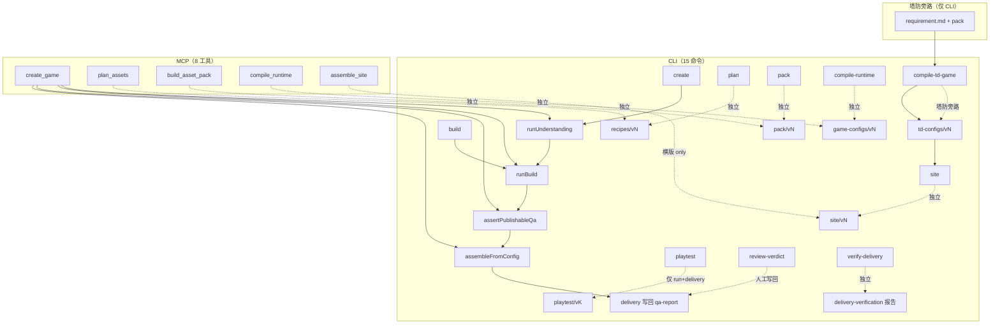

# P0-01 · 生成管线只读能力审计

> 文档类型：只读能力审计 / 开发决策输入  
> 需求编号：P0-01  
> 目标分支：`main`  
> 生产代码审计基线：`2c1a9d55c1ac94bc5271318514897b9485587bec`（`2c1a9d5`）  
> 审计时间：2026-10-29  
> 审计方式：只读代码、测试与真实证据；未修改生产代码、契约、CLI、MCP 或依赖；未付费调用；未重跑生成或浏览器试玩  
> 详细证据：`.scratch/p0-01-audit/research/01-baseline.md` … `09-decision-report.md`  
> HITL 裁定：`.scratch/p0-01-audit/rulings-2026-10-29.md`

---

## 0. 结论摘要

1. **当前管线真实支持什么？** 两条生产链：横版 `create/build → 理解六步 → 资源包 → 配置 → QA → 站点 → delivery`（有一组完整真实 E3，但只有一个 Demo）；塔防 `需求 + 资源包 → compile-td-game → td-config → site`（有纯层实现与 fixture 渲染，但**没有设计层、QA、delivery、Playtest**）。CLI 有 15 个命令，MCP 只有 8 个工具；MCP 只有 `create_game` 能走完横版全链，且无真实 E3。
2. **哪些只有局部测试或 fixture 证据？** `import` / 程序化资源路线、TD 站点与玩法、MCP 全链、独立 CLI `verify`、`playtest-baseline`、HEAD 的 v2 CLI Playtest 写回、`buildAndSite` 的 delivery 壳级写回。它们有实现或 E2，但没有覆盖该声明的真实 E3。
3. **哪些机制尚未得到真实运行验证？** 横版 10 条机制中，交付级 E3 只有 3 条（`collect-pickup` / `open-chest` / `reach-goal`），严格从闭集声明起点全链只有 2 条；`hazard-contact` 有真实发生但无正向判定；`avoid-danger` 只有 fixture probe；`moving-platform` 无运行时；`run` / `jump` / `gravity` / `collide-terrain` 只有间接观测。
4. **第二个 Demo 最可能在哪里失败？** `buildAndSite` 的 delivery 壳级 E3、HEAD 的 v2 Playtest 写回、Playtest 默认场景写死 wasteland 常量、没有平台可通关求解器、新交付没有正式证据清单；以及新的视觉世界/人工审核。
5. **下一项最值得实施的工程需求是什么？** **P0-02：A（平台探索/收集）付费试跑**。它是当前证据下唯一能直接检验“第二条交付链能否成立”的最小实验。
6. **为什么它优先于其他候选？** A 的核心机制有交付级 E3、主路径不需要新运行时/契约；B 的假绿链是独立正确性缺口，不应混入 A；C 塔防与 D 俯视角解谜都是平台级接入/运行时扩展，不是一份第二 Demo 的改动。

**一句话结论：** 现有管线**可能**支持第二个横版 Demo，但当前证据只证明了一个 Demo；A 是进入实施的最小候选，必须以 P0-02 的真实运行结果为准，不能把历史 E3 或缺失的壳级证据默认为通过。

---

## 1. 审计基准与范围

| 项 | 值 |
|---|---|
| 仓库 | `https://github.com/sihuayin/game-maker.git` |
| 分支 | `main` |
| 生产代码基线 | `2c1a9d55c1ac94bc5271318514897b9485587bec`（`2c1a9d5`） |
| 本期审计 HEAD（effort 提交） | 见 `.scratch/p0-01-audit/research/01-baseline.md`；`2c1a9d5..HEAD` 的 `packages/`、`scripts/`、`package.json`、lockfile、tsconfig diff 为空 |
| 工作区 | 审计期间只新增 `.scratch/p0-01-audit/**` 与本文件；PRD `docs/v7.6/管线.md` 为未提交工作区输入 |
| 范围 | PRD §3.1 的 10 个能力域；横版与 TD 两条链；所有真实入口（CLI 15 命令、MCP 8 工具、TD 旁路、effort/probe 工具） |
| 非目标 | 修改生产代码/契约/CLI/MCP/依赖；付费调用；重新生成资源/站点；启动第二个 Demo；覆盖历史产物；修改测试以改变结果 |

**证据分级**：E0 推测 / E1 源码 / E2 自动化测试 / E3 真实运行 + 命令 + 退出码 + 路径 + 产物身份。历史 E3 只证明其来源 commit、交付身份与实际覆盖场景，不自动升级为 HEAD 的证明。

**审计命令边界**：只读 shell、`pnpm test`、`pnpm typecheck/build`（仅 `.gitignore` 的 `dist/`）、`verify`、`inspect`、`accept` / `verify-delivery` / `test:evidence` / `site` 加 `--out <tmp>`。禁止生成、试玩、付费、浏览器探针与写历史命令。详见 `research/02-safe-commands.md`。

---

## 2. 真实生成管线图

**横版真链**：`输入（style.png + intent）→ 理解六步 → asset-recipe → pack → verify → game-config → QA（7 判据 + 机制覆盖）→ 发布闸 → site → delivery`。站点装配在壳层，不在 `pipeline`。

**塔防旁路**：`需求文本 + 已有资源包 → compile-td-game → td-config → site`。没有 `GameIntentSpec / GameDesignSpec / CharacterDNA / VisualDesign / AssetRecipe`；发布闸显式跳过 TD，因此没有 delivery/playtest。

**独立命令面**：`plan` / `pack` / `compile-*` / `site` / `verify` / `inspect` / `accept` / `review` / `playtest` / `verify-delivery` 各自从磁盘读输入、写自己的版本目录，不自动串联。独立 `site` 不写 delivery，而 `playtest` 要求 delivery + site pass ⇒ 手工 `plan/pack/compile/site` 路线不可试玩。

**真实 vs 文档 vs fixture**：`README.md` 与 PRD 的线性八段是设计意图；真实分支、入口差异与 fixture-only 路径见 `research/03-real-pipeline.md` §2–§5。目录存在不等于功能完整（如 `fixtures/playtest-baselines/` 只有 README）。

---

## 3. 能力矩阵

完整 52 行（10 域 × 能力/入口/场景）见 `research/04-capability-matrix.md` §2。状态分布：**`E2E_VERIFIED` 31 · `TESTED` 17 · `UNKNOWN` 4 · `BLOCKED` 0**；31 条 E2E 行只来自 7 组独立真实运行，不能读成 31 个独立证明。

| # | 能力域 | 主要结论 | 代表状态 |
|---|---|---|---|
| 1 | 输入与游戏意图解析 | 1 张 PNG + 需求文本/`.md` 可走真实链；多图、非 PNG 未实现 | `E2E_VERIFIED`（单样本） |
| 2 | 风格与视觉世界描述 | 参考图 → VisualWorldSpec / StyleSpec / VisualDesign / CharacterDNA 有真实产物；只有第二个世界未验证 | `E2E_VERIFIED`（单样本） |
| 3 | 游戏设计与机制表达 | 仅 `platformer/v1`；R12 拒绝只有 E2；TD 不经设计层 | `E2E_VERIFIED`（单样本）/ `TESTED` |
| 4 | 资源规划、生成、打包及验证 | `generated` 路线有完整 E3；`import` / 程序化路线只有 E2；独立 CLI `verify` 无 E3；`accept` 有旧包 E3 | `E2E_VERIFIED` / `TESTED` |
| 5 | 关卡配置与运行时编译 | 横版 config 有完整 E3；TD `compile-td-game` 无真实模型输出 E3 | `E2E_VERIFIED` / `UNKNOWN` |
| 6 | Demo 启动、玩家控制及目标达成 | 冻结横版 Demo 有 Chrome/Playtest 成功 E3；TD 玩法 UNKNOWN；第二 Demo 未运行 | `E2E_VERIFIED`（单样本）/ `UNKNOWN` |
| 7 | Playtest 执行、观测、分类与写回 | 真跑浏览器、五态 + UNKNOWN + not-executed；v1 有 CLI 写回 E3，HEAD v2 组合无 E3 | `E2E_VERIFIED`（v1）/ `TESTED`（v2） |
| 8 | 人工视觉确认 | 一次独立记录、6 项全 pass、11/11 身份 verified；机器不重判；独立性/可重复性 UNKNOWN | `E2E_VERIFIED`（单次）/ `UNKNOWN` |
| 9 | `verify-delivery` 与证据完整性 | HEAD 独立重跑 pass：223 文件 / 13 records / 六项全 match / diagnostics 0；1,035 受保护文件零变化 | `E2E_VERIFIED` |
| 10 | 版本隔离、历史交付保护与测试约束 | 版本目录原子分配、不覆盖；`create --yes` 测试依赖未入库 `dist/shell.js`；并发负载下整仓测试曾超时 | `TESTED` |

**边界**：横版主链的完整 E3 只有 `wasteland-scavenger-recipe` v1 一个 Demo、一个设计样本、一次成功 Playtest。TD 只有纯层仿真与 fixture 渲染。MCP 全链只有 E2。历史 E3 不是 HEAD 重跑。

---

## 4. 机制与可观测性矩阵

完整六段链路（声明 → 配置 → Runtime → 触发 → 观测 → Playtest 判定）见 `research/05-mechanism-observability.md` §3。核心表：

| # | 机制 | 实现 | 交付级 E3 | 主要缺口 |
|---|---|---|---|---|
| 1 | `run` | 有 | 仅间接（`playerX`） | 无机制级断言 |
| 2 | `jump` | 有 | 仅间接（9 次 jump/land） | 无机制级断言 |
| 3 | `gravity` | 有 | 仅间接 | 未被设计声明 |
| 4 | `collide-terrain` | 有 | 仅间接 | 未被设计声明 |
| 5 | `collect-pickup` | 有 | **有** | 单样本 |
| 6 | `moving-platform` | **无运行时** | 无 | `solid+motion` 可静默写入；R12 仅设计层拒绝 |
| 7 | `hazard-contact` | 有 | 真实发生（`reset=10`）但无正向判定 | 无“撞到 ⇒ 正确复位”断言 |
| 8 | `reach-goal` | 有 | **有** | 未写入 `design.mechanics[]` |
| 9 | `open-chest` | 有 | **有** | config 提示词 `kind` 漏 chest |
| 10 | `avoid-danger` | 有 | 仅 fixture probe | 冻结设计声明而 config 无 danger，覆盖仍 `satisfied` |

**三处系统性断点**：

1. **声明 → 配置没有机械保证**：config 编译器不读 `design.mechanics`，`kind` 铁律漏 `chest` / `danger`，骨架无 chest/danger。冻结交付同时演示了两个方向：`open-chest` 落地、`avoid-danger` 消失；`reach-goal` / `hazard-contact` 在 config 真实实现却不在设计声明里。
2. **覆盖门禁只读 design**：`buildMechanicCoverage` 不检查 config；生产调用不传 `probeResults`，QA 层默认全 passed；覆盖报告不落盘。`avoid-danger` 可以在没有 danger 实体的交付上拿 `satisfied`。
3. **Playtest 判定不是机制通用**：默认场景写死 `siteVersion=1`、`initialActivePickups=4`、`collected=6`；默认只断言 pickups/collected/won，不断言 chest-open/danger-hit/reset/jump/moving。第二个 Demo 要么自带场景数据，要么会被误判。

**计数**：实现 9/10；交付级 E3 3/10；严格闭集全链 2/10；真实运行间接 4/10；仅 probe 1/10；真实发生无判定 1/10；无运行时 1/10；交付级 E3 失败路径 0/10。塔防 9 类构念只有纯层仿真，无设计/QA/delivery/Playtest。

---

## 5. Playtest、人工视觉及证据完整性审计

八项逐条见 `research/06-playtest-visual-evidence.md`。摘要：

1. **Playtest 真跑浏览器**：系统 Chrome + CDP + 本地只读 HTTP + 真实键盘；站点字节前后哈希不变。
2. **状态采集是轮询快照差分**：约 35ms + CDP 往返；瞬时事件结构性可能漏采；读不到状态会记 gap 并降为 UNKNOWN，但两次成功读取之间漏掉的事件不会留 gap。
3. **结果分类完整**：五态 + UNKNOWN + not-executed，19 个归因用例；但交付默认只要求一个 happy-path，非 SUCCESS 没有真实 E3（除一次 `AGENT_LIMITATION` 沙箱）。
4. **身份绑定**：site/pack/config/shell/harness/rules + 校验和；CLI 六项准备与写回复核；缺口是无 runId/attempt nonce，harness/rules 版本只记录不强制。
5. **人工视觉**：review-record / capture / materials / 补审独立存在，与冻结身份匹配（11/11）；是 verdict pass 的必要条件；机器只验完整性/一致性，不重判人工结论；独立性与可重复性 UNKNOWN。
6. **`verify-delivery`**：验清单 schema、双端 realpath、文件哈希、六字段身份、三方哈希、站点完整性、报告引用、视觉材料、playtest 摘要/attempts/投影、六项重导出、declared vs recomputed；不构建、不跑 QA、不启动浏览器。
7. **拒绝通过**：缺失/不可读 → blocked；篡改/身份不符/引用错/声明与重算不符 → fail；exit 0 只在 pass。残留口：失败重跑不撤销旧 pass；`review-verdict` 不校验身份/材料。
8. **负向测试**：验收器 18 + CLI 6；缺口是 CLI playtest 准备层无测试、视觉非全 pass 与 playtest 摘要不一致无负向、无 harness/rules 版本用例。

**证据存在 / 有效 / 真实必须分开**：文件存在不等于身份匹配；哈希/身份通过不等于内容真实反映事件；人工视觉只能核对记录，不能机器重判。信任边界：清单与被验证据一起改并提交无法自证，靠 git 历史与人工审查。

---

## 6. 第二个 Demo 候选评估

完整比较见 `research/07-second-demo-candidates.md`。当前运行时只有 `platformer/v1`（单屏高、横向滚动、`collect-then-reach`），所以类型级差异需要新运行时/契约。

| 候选 | 玩法差异 | 证据 | 风险/成本 | 结论 |
|---|---|---|---|---|
| **A 平台探索/收集** | 内容级（关卡/视觉/节奏） | 最强：`collect-pickup` / `open-chest` / `reach-goal` 有交付级 E3 | 最低；主路径无生产代码变更 | **唯一优先候选（HITL 裁定）** |
| **B 危险时序** | 机制重心级（`hazard-contact` + `avoid-danger`） | 中：危险有真实发生但无正向判定；avoid-danger 仅 fixture probe | 中；需补声明→配置→覆盖→判定链 | 独立缺口，不进入本期 |
| **C 塔防** | 类型级 | 最弱：无设计/QA/delivery/Playtest，compile 无真实模型 E3 | 最高；平台级接入 | 不进入本期 |
| **D 俯视角解谜/运行时扩展** | 类型级 | `BLOCKED`：缺 top-down 相机、四向移动、交互/目标机制与配置形状 | 平台级 | 不进入本期 |

**HITL 裁定（2026-10-29）**：唯一候选 **A**；允许另立 P0-02 付费试跑，但**付费执行需另行明确预算授权**；只新增输入（新 intent、参考图、自定义 scenario），不改生产代码、不手改中间 JSON、不新增运行时/契约；核心验收 `collect-pickup` + `reach-goal`，`open-chest` 可选；使用新参考图 → 新视觉世界/资源包；证据为真实运行 + delivery 报告 + 真实浏览器 Playtest，新交付正式清单与 `verify-delivery` 留作后续缺口。逐字裁定见 `.scratch/p0-01-audit/rulings-2026-10-29.md`。

**A 的主要失败风险**：几何不可通关（无求解器，QA 只报警告）；交付信封未证明；默认场景常量不匹配；新视觉/资源过不了层覆盖、背景覆盖、HUD 或人工视觉。

---

## 7. 已确认缺口与未知事项

完整六类缺口、逐条证据、最小动作、审批与优先级见 `research/09-decision-report.md`。计数：已具备 6 · 已实现需补证据 7 · 生产实现缺口 10 · 机制不可观测/判定 6 · 证据/身份/版本管理缺口 7 · 证据不足 7。

**最高风险（按对 A 的影响）**：

1. `buildAndSite` 的 delivery 写回**没有壳级 E3**；冻结 Demo 的 delivery 由 effort 脚本初始化。
2. HEAD 的 **v2 Playtest CLI 写回没有 E3**；交付内是 harness/rules v1。
3. Playtest **默认场景写死 wasteland 常量**（4 pickup / 6 collected / site v1），A 的计数不同会假失败。
4. 没有平台可通关求解器；几何可能不可通关，QA 只报警告。
5. 新交付没有正式证据清单 / `verify-delivery` 路径；清单生成器是 effort 工具，不在 `packages/`。

**独立正确性缺口（不阻塞 A，但必须保留）**：

- `avoid-danger` 假绿链：设计声明、config 无 danger、覆盖仍 `satisfied`、Playtest 无正向断言。
- `hazard-contact` 有真实 `reset=10` 但无正向判定。
- `moving-platform` 无运行时，`solid+motion` 可静默写入。
- `review-verdict` 不校验身份/材料；失败重跑不撤销旧 pass。

**UNKNOWN（4 项，来自能力矩阵）**：TD 玩家控制/目标达成；人工视觉独立性与可重复性；期望哈希清单的生产入口；并发版本分配/多进程写入。另加 A 本身“能否生成”作为 P0-02 待答的 UNKNOWN。

---

## 8. 下一步开发建议

**唯一优先事项：P0-02 A（平台探索/收集）付费试跑。**

理由：

1. 用户 HITL 裁定 A 进入实施；B 的假绿链是独立缺口，C/D 不进入本期。
2. A 的核心机制有交付级 E3，主路径不需要新运行时/契约或生产代码改动。
3. 它是当前证据下唯一能直接检验“第二条交付链能否成立”的最小实验；失败也会留下可审计的失败证据。
4. 它能同时补上三个关键缺口：delivery 壳级 E3、HEAD v2 Playtest 写回 E3、第二个 Demo 未运行。

**最小解除方案**：

- **预算授权**：文本 + 生图 + 浏览器试跑的明确预算；未获授权则暂停，不降级复用旧包。
- **输入**：新 intent、新参考图（新视觉世界）、A 的自定义 Playtest 场景数据（现有 `--scenario-dir`，不手改中间 JSON）。
- **执行**：`create --yes`（或 `create` + `build`）→ `playtest --scenario-dir` → 保存命令 / 退出码 / 路径 / 新交付身份；不改生产代码、不手改中间 JSON。
- **证据**：真实运行 + delivery 报告 + 真实浏览器 Playtest；新交付的正式清单与 `verify-delivery` 明确留作后续缺口。
- **成功判据**：由新交付的冻结身份、真实运行结果和可追溯 Playtest 证据共同决定；不得用历史 E3 替代，也不得把壳级 delivery E3 / v2 playtest 写回 / 正式清单缺失默认为已通过。
- **失败处理**：几何不可通关、QA/视觉/Playtest 失败都按真实证据记录；不修到通过。

**并行但不阻塞 A 的后续需求**（不在本期实施）：机制声明→配置→覆盖→判定链修复（G3-1/2/3/5、G4-1/2）；新交付证据清单生成；MCP/TD 全链；人工视觉独立性与版本强制。

---

## 9. 证据引用索引

| 证据 | 位置 | 用途 |
|---|---|---|
| 审计基线 | `research/01-baseline.md` | `2c1a9d5`、工作区、包结构、排除项 |
| 命令边界 | `research/02-safe-commands.md` | 允许/禁止的审计命令与副作用 |
| 真实管线 | `research/03-real-pipeline.md` | 两条链、入口差异、真实/文档/fixture 区分 |
| 能力矩阵 | `research/04-capability-matrix.md` | 52 行、E-01…E-15 证据索引 |
| 机制矩阵 | `research/05-mechanism-observability.md` | 10 条机制六段链路、三处断点 |
| Playtest/视觉/证据 | `research/06-playtest-visual-evidence.md` | 八项逐条、证据边界、负向测试 |
| 候选比较 | `research/07-second-demo-candidates.md` | A/B/C 八维比较、A 的缺口/风险 |
| HITL 裁定 | `rulings-2026-10-29.md` | 唯一候选与进入实施条件（逐字） |
| 决策报告 | `research/09-decision-report.md` | 六类缺口、优先级、最小解除方案 |
| 冻结证据重验 | `.scratch/evidence-integrity-v1/runs/2026-10-29T05-04-57Z-final-acceptance/` | 223 文件 / 13 records / 六项 match / diagnostics 0 |
| 冻结清单 | `.scratch/evidence-integrity-v1/manifest/expected-hashes.json` | sha `ba7a485b…36fd`，223 文件（151 required / 72 optional） |

**关键历史 E3 来源**：`040b907`（真实 create）、`5b8283f`（冻结/playtest v1/视觉）、`5f29592` / `8e92c69`（harness v2 重跑）、`cf817c1`（AGENT_LIMITATION 沙箱）、`c619d84`（旧包 accept）、`d3e9137`（TD fixture 渲染）。每条只证明其来源 commit + 交付身份 + 实际覆盖场景。

---

## 10. 审计限制与未完成事项

1. **只读边界**：未运行 `create/build/plan/pack/compile-*`、`playtest`、整条 `test:playtest`、`review`、`review-verdict`、`playtest-baseline`、浏览器探针或 `pnpm install`；未付费；未写历史/受跟踪目录；未提交/推送。
2. **历史 E3 不是 HEAD 重跑**：`040b907` / `5b8283f` / `5f29592` / `8e92c69` / `cf817c1` / `c619d84` / `d3e9137` 的证据只对其来源 commit 与交付身份成立；HEAD `2c1a9d5` 的直接证据是 `verify-delivery` 重跑与 `040b907..2c1a9d5` 的代码漂移核对。
3. **单 Demo**：所有横版 E3 只覆盖 `wasteland-scavenger-recipe` v1 一个 Demo、一个设计样本、一次成功 Playtest；不能外推为“管线普遍支持第二个玩法”。
4. **测试环境不稳**：能力矩阵子代理在并发审计负载下两次整仓 `pnpm test` 超时（`collect` 最长 804s），超时用例隔离重跑 60/60、94/94 全过；历史最终验收记录整仓 149/2231 全绿。本审计不据此判生产能力失败，也不宣称本次复现了整仓绿。
5. **人工视觉**：只核对记录/身份/材料一致性，不能机器重判“人确实看了”；独立性与可重复性 UNKNOWN。
6. **信任边界**：哈希清单能发现相对清单的改动；发现不了清单与被验证据一起改并提交——后者由 git 历史与人工审查负责。
7. **新交付证据**：A 的正式证据清单与 `verify-delivery` 不在本期；A 成功后仍需另立“新交付证据清单”需求。
8. **平台**：符号链接/路径安全测试在 macOS 验证；Windows 未验证。
9. **A 未运行**：当前管线能否生成 A 仍为 UNKNOWN；P0-02 才能回答。本文不预设通过。

---

## 附录 A：PRD §8 可合并验收清单

### 文档完整性

- [x] 文件位于 `docs/v7.6/p0-01-readonly-capability-audit.md`
- [x] 审计基准记录了完整 commit SHA（`2c1a9d55c1ac94bc5271318514897b9485587bec`）
- [x] 10 个能力域均有结论（§3；完整 52 行见 `research/04`）
- [x] 能力矩阵引用可定位到 `research/04` 的 `path:line` / 测试 / E-* 证据
- [x] 明确标注 `UNKNOWN` 与 `BLOCKED`（§7；能力矩阵 4 个 UNKNOWN，0 个 BLOCKED；机制矩阵 1 个 BLOCKED）

### 证据质量

- [x] 生产实现、自动化测试、fixture、真实 E2E 彼此区分（§1/§3/§4；`research/03` §1/§5）
- [x] 真实 E2E 声明有运行身份与证据来源（§9；`research/04` §3）
- [x] 历史报告没有被误当作当前版本的直接证明（§10；`research/04` §1.3）
- [x] 没有凭文档描述或目录名称推断功能（§2；`research/03` §5）

### 范围控制

- [x] 没有生产代码变更（`git diff 2c1a9d5..HEAD -- packages scripts package.json pnpm-lock.yaml tsconfig*` 为空）
- [x] 没有契约、CLI、MCP 或依赖变更
- [x] 没有付费调用
- [x] 没有覆盖历史交付物
- [x] 没有提前生成第二个 Demo

### 决策价值

- [x] 给出唯一优先的第二个 Demo 候选（A；§6）
- [x] 给出最小阻塞解除方案（§8）
- [x] 最终推荐由真实证据支持（`research/04/05/07/09`）
- [x] 明确第二个 Demo 是否可以进入实施（可以：A，条件性；§6/§8）

---

*本文件只记录审计结论与决策输入；实现、修复与第二个 Demo 的生成不在 P0-01 范围内。*
